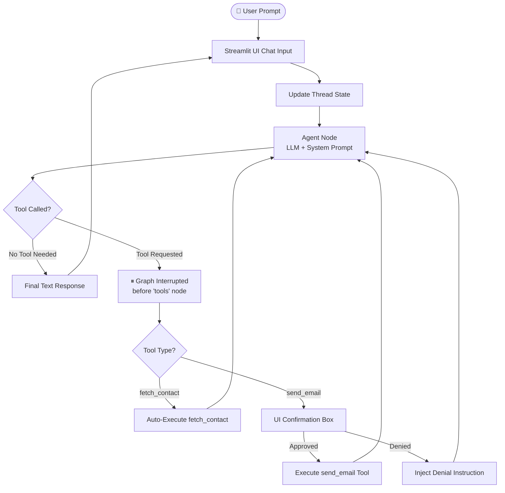

# Autonomous AI Email Agent

An enterprise-ready AI Email Agent built with **LangGraph**, **Streamlit**, and **NVIDIA API Catalog** models (via OpenAI-compatible endpoint). 

The agent accepts natural language requests to look up contact details, draft professional emails, request explicit human confirmation before sending, and execute email delivery via Gmail SMTP.

---

##  Key Features

- **Autonomous Intent & Entity Extraction**: Parses recipient names, meeting details, subject lines, and appropriate tone from unstructured prompt text.
- **Dynamic Contact Lookup**: Queries `contacts.json` database via a dedicated tool when recipient email addresses are not provided.
- **Human-in-the-Loop (HITL) Safety Gate**: Pauses execution graph prior to triggering email transmission, requiring explicit user approval/denial in the UI.
- **Multi-Turn Context Persistence**: Reuses conversation state across multiple user queries (e.g., *"Send the same email to Sarah too"*).
- **Dual-Pane Streamlit UI**: Chat UI on the left side, with real-time execution node tracking per query on the right pane.
- **Logging**: Writes execution traces, tool arguments, and human choices to `agent_history.log`.

---

##  Agent Architecture & Graph Flow

The agent is modeled as a stateful graph in LangGraph with explicit tool interruption rules:



---

##  Project Structure

```text
.
├── .env                # API keys and SMTP credentials
├── README.md           # Project documentation
├── agent.py            # LangGraph StateGraph agent definition
├── app.py              # Streamlit dual-pane UI & execution loop
├── contacts.json       # Mock JSON contact store
├── requirements.txt    # Python dependencies
└── tools.py            # Custom tools (fetch_contact, send_email)

```

---

##  Setup & Installation

### 1. Prerequisites

* Python 3.10+
* A Google App Password for Gmail SMTP delivery ([Generate one here](https://myaccount.google.com/apppasswords)).
* An API Key from the [NVIDIA API Catalog](https://build.nvidia.com/).

### 2. Clone & Install Dependencies

```bash
# Install dependencies
pip install -r requirements.txt

```

### 3. Environment Configuration

Create a `.env` file in the project root directory:

```env
NVIDIA_API_KEY=nvapi-your_nvidia_api_key_here
SENDER_EMAIL=your_gmail_address@gmail.com
SENDER_PASSWORD=your_16_character_app_password

```

### 4. Populate Contact Store

Add or modify contacts in `contacts.json` omitied for privacy:

```json
{
    "John": "john.doe@example.com",
    "Sarah": "sarah.smith@example.com",

}

```

---

##  Running the Application

Launch the Streamlit web app:

```bash
streamlit run app.py

```

### Example Prompt Flow

1. **User Query**: `"Send an email to Kunal reminding him about tomorrow's 10 AM meeting."`
2. **Step 1 (Auto)**: Agent triggers `fetch_contact("Kunal")` to look up the email address.
3. **Step 2 (Auto)**: Agent drafts email subject and body text.
4. **Step 3 (HITL Pause)**: Agent pauses before sending. UI presents approval box displaying recipient, subject, and body.
5. **Step 4 (User Action)**: Click **Approve & Send** to deliver via Gmail SMTP or **Deny & Edit** to revise context.

```

